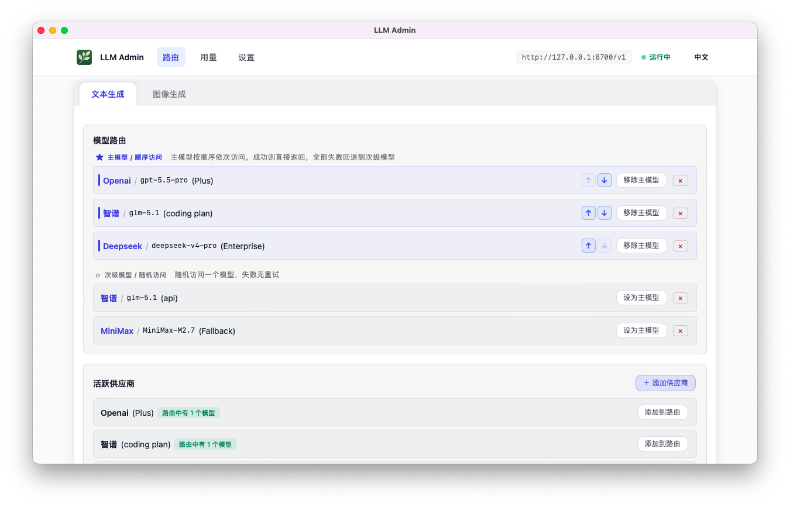

# LLM Admin — 省钱可靠模型搭档

统一调用 100+ 大模型，桌面端本地管理，省钱又省心。

## 预览

<div align="center">
  
</div>

## 特性

- 🖥️ **桌面端应用** — 基于 Neutralino.js 的跨平台桌面客户端（默认窗口 1280×840），开箱即用
- 🔌 **统一接口** — HTTP 统一调用 100+ 大模型，支持**图像生成**和**文本生成**
- 🔄 **协议转换** — 同时兼容 OpenAI `/v1/chat/completions` 和 Anthropic `/v1/messages` 协议，自动互转
- 🧭 **自定义路由** — 声明式模型路由、**故障转移**和**负载均衡**策略
- 🤖 **智能路由** — 按文本 / 图像 / 视频 / 音频 模态智能分配模型
- 📊 **用量统计** — 内置管理界面，实时查看模型用量和消费统计
- 🔌 **插件系统** — 支持客户端缓存、Guardrails 等扩展能力
- 🔒 **本地部署** — 所有数据保留在本地，无需外部 SaaS

## 快速开始

### 下载桌面端

从 [Releases](https://github.com/leaf-llm/llmadmin-ui/releases) 下载对应平台的桌面端应用，开箱即用。

### 或从源码运行

```bash
# 1. 克隆仓库
git clone https://github.com/leaf-llm/llmadmin-ui
cd llmadmin-ui

# 2. 安装依赖（UI + gateway submodule）
git submodule update --init --recursive
npm install
npm --prefix src-gateway install

# 3. 启动 Web 开发模式（UI + gateway 一条命令）
npm run dev:web
# 或分开：
# npm run dev:ui      # Web UI（5173）
# npm run dev:gateway # 网关（8700）

# 或构建桌面端
npm run build:desktop
```

> 本桌面端是 llmadmin-core 的前端界面，用于可视化修改 `conf.json` 配置、管理提供商和路由策略等。

## 部署到 Web / Render

同一个仓库现在也可以作为 Web 服务运行，无需桌面端。默认模板使用 **Render + 文件存储**，不需要数据库，也不需要持久磁盘：

[](https://render.com/deploy?repo=https://github.com/leaf-llm/llmadmin-ui)

部署后：

1. 在 Render Dashboard → 服务 → Environment 复制 `ADMIN_TOKEN` 和 `GATEWAY_API_KEY`；
2. 打开 `https://<service>.onrender.com/public/admin/`，用 `ADMIN_TOKEN` 登录；
3. 添加 provider、模型路由；
4. 客户端用 `Authorization: Bearer <GATEWAY_API_KEY>` 调用 `/v1/chat/completions` 或 `/v1/messages`。

> ⚠️ 默认文件模式写入容器 `/tmp`，**服务重启、重新部署或免费实例休眠后可能丢失配置**。需要持久化时再切换到 PostgreSQL/Neon（见部署文档）。

详细说明：

- [Render 部署](docs/deploy/render.md)
- [Docker / 其他 PaaS](docs/deploy/docker.md)
- [Web 安全清单](docs/web/security.md)
- [Web 架构与限制](docs/web/architecture.md)

本地 Docker：

```bash
cp .env.example .env
docker compose up --build
# http://localhost:8700/public/admin/
```

## 架构

```
┌──────────────────────────────────────┐
│         桌面端 (Neutralino)           │
│  ┌────────────────────────────────┐  │
│  │     Admin UI (React + Vite)    │  │
│  │  ┌──────┐ ┌──────┐ ┌──────┐  │  │
│  │  │提供商│ │用量  │ │设置  │  │  │
│  │  └──────┘ └──────┘ └──────┘  │  │
│  └──────────────┬─────────────────┘  │
└─────────────────┼────────────────────┘
                  │
┌─────────────────▼────────────────────┐
│     llmadmin-core (Hono + Bun/Node)   │
│  ┌───────────────────────────────┐   │
│  │  路由引擎   │   协议转换       │   │
│  │  故障转移   │   负载均衡       │   │
│  │  插件系统   │   用量统计       │   │
│  └───────────────────────────────┘   │
└─┬──────────┬──────────┬──────────┬───┘
  │          │          │          │
  ▼          ▼          ▼          ▼
OpenAI   Anthropic   DeepSeek   100+ 模型
```

## 开发

```bash
npm run dev                 # 等同 dev:web
npm run dev:web             # Web 开发：UI（5173）+ 网关（8700）
npm run dev:ui              # 仅 Web UI
npm run dev:gateway         # 仅网关
npm run dev:desktop         # 桌面端开发模式

npm run build               # Web 完整构建（UI + gateway）
npm run build:web           # 仅 Web UI
npm run build:gateway       # 仅 gateway
npm run build:desktop       # 桌面端（含 Bun 二进制与 Neutralino 打包）

npm run setup:desktop       # 首次桌面端开发前更新 Neutralino 运行时
```

## 许可证

[Apache-2.0](LICENSE)
